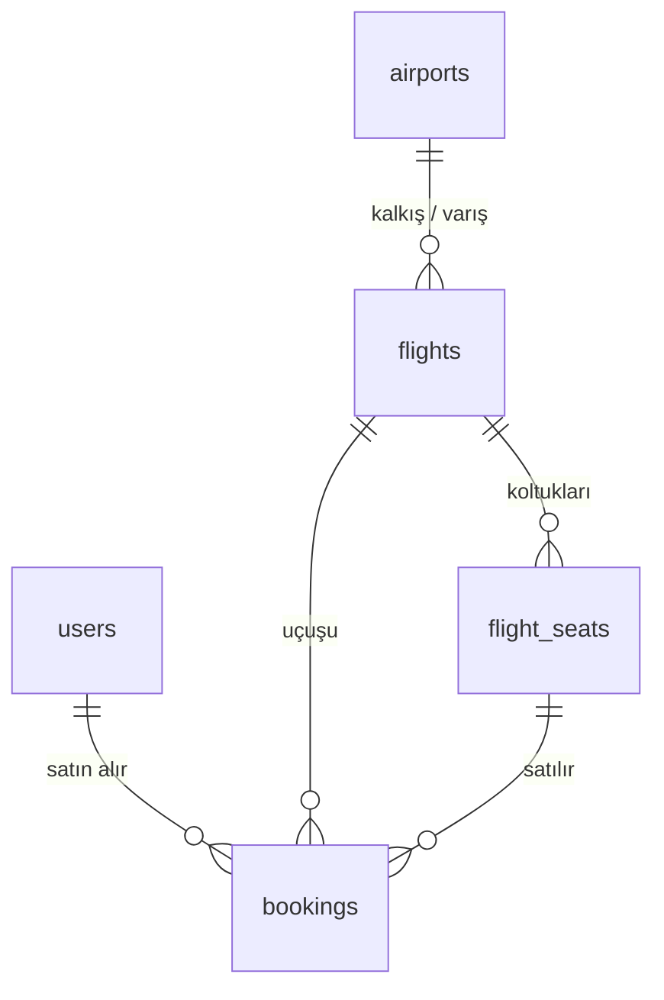

<div align="center">

# ✈️ Flight Ticket Purchasing System

**CEN317 Engineering Design · Team 19**

Kalkış-varış noktaları ve tarihlere göre uçuş aranan, koltuk seçimi yapılarak bilet satın alınan seyahat platformu.


</div>

---

## 📑 İçindekiler

- [Proje Hakkında](#-proje-hakkında)
- [Proje Durumu](#-proje-durumu)
- [Klasör Yapısı](#-klasör-yapısı)
- [Ekip ve Görev Dağılımı](#-ekip-ve-görev-dağılımı)
- [Kurulum](#-kurulum)
- [Test Hesapları ve Örnek Veriler](#-test-hesapları-ve-örnek-veriler)
- [Veritabanı Özeti](#-veritabanı-özeti)
- [API Uç Noktaları](#-api-uç-noktaları)
- [Git Çalışma Kuralları](#-git-çalışma-kuralları)

---

## 🎯 Proje Hakkında

Kullanıcı kayıt olup giriş yapar, kalkış-varış havalimanı ve tarih seçerek uçuş arar, uçağın koltuk haritasından koltuğunu seçer ve bileti satın alır. Satın alma sonunda bir **PNR kodu** üretilir ve bilet **PDF** olarak indirilebilir.

**Projede istenen özel gereksinimler:**

| # | Gereksinim | Sorumlu |
| :-: | :--- | :--- |
| 1 | Uçuş güzergâhlarının **harita üzerinde** görselleştirilmesi | 2. Üye |
| 2 | Aktif koltuk seçiminde **eşzamanlılık (concurrency)** çakışma yönetimi | 3. Üye |
| 3 | Bilet alındığında **PNR koduna ait biletin PDF** çıktısının üretilmesi | 3. Üye |

---

## 📊 Proje Durumu

> Bir iş bittiğinde bu tabloyu güncelleyin: ⏳ Bekliyor · 🚧 Yapılıyor · ✅ Tamamlandı

| Modül | Durum | Not |
| :--- | :-: | :--- |
| Veritabanı şeması ve örnek veriler | ✅ | `database/` |
| Kullanıcı kayıt / giriş (backend) | ⏳ | |
| Uçuş arama API | ⏳ | |
| Koltuk haritası API | ⏳ | |
| Bilet satın alma API | ⏳ | |
| Arayüz (arama, koltuk seçimi, ödeme) | ⏳ | |
| Harita görselleştirme | ⏳ | |
| Koltuk kilitleme (concurrency) | ⏳ | |
| PNR üretimi ve PDF bilet | ⏳ | |

---

## 📁 Klasör Yapısı

```text
Flight-Booking-System/
├── database/       # Veritabanı şeması (schema.sql), örnek veriler (seed.sql) ve dokümanı
├── backend/        # Sunucu tarafı ve API servisleri
├── frontend/       # Kullanıcı arayüzü ve harita üzerinde uçuş güzergâhı görselleştirme
├── concurrency/    # Aktif koltuk seçiminde eşzamanlılık (concurrency) çakışma yönetimi
└── ticket-pdf/     # PNR kodu üretimi ve bilet PDF çıktısı oluşturma
```

---

## 👥 Ekip ve Görev Dağılımı

| Ekip Üyesi | Sorumluluk Alanı | Çalışacağı Klasörler |
| :--- | :--- | :--- |
| **1. Üye** | Backend & Veritabanı | `database/`, `backend/` |
| **2. Üye** | Frontend & Harita Görselleştirme | `frontend/` |
| **3. Üye** | Eşzamanlılık (Concurrency) & PNR PDF Çıktısı | `concurrency/`, `ticket-pdf/` |

---

## 🚀 Kurulum

### Gereksinimler

- [Git](https://git-scm.com/)
- [PostgreSQL 17](https://www.postgresql.org/download/windows/) (pgAdmin 4 ile birlikte)

### 1. Projeyi indir

```bash
git clone https://github.com/burcuyasanerr/Flight-Booking-System.git
cd Flight-Booking-System
```

### 2. Veritabanını kur

1. **pgAdmin 4**'ü aç → **Servers** altındaki sunucuna bağlan.
2. **Databases** → sağ tık → **Create → Database** → adı: `flight_booking`
3. `flight_booking` → **Tools → Query Tool**
4. Klasör ikonu ile `database/schema.sql` aç → **F5**
5. Klasör ikonu ile `database/seed.sql` aç → **F5**

Kontrol için yeni bir Query Tool'da çalıştır, **2 satır** gelmeli:

```sql
SELECT * FROM v_flight_search WHERE departure_code = 'IST' AND arrival_code = 'ESB';
```

> 💡 Veritabanı bozulursa ya da `database/` klasörü güncellenirse 4. ve 5. adımı tekrar çalıştırman yeterli. `schema.sql` her şeyi silip baştan kurar.

<details>
<summary>⚠️ pgAdmin sunucuya bağlanamıyor ("connection timeout expired")</summary>

PostgreSQL servisi çalışmıyordur.

1. **Win + R** → `services.msc` → **postgresql-x64-17** → sağ tık → **Başlat**
2. Listede servis yoksa kurulum yarım kalmıştır. **Yönetici olarak** açılmış CMD'de (satır başı `C:\Windows\System32>` olmalı):

```bat
cd "C:\Program Files\PostgreSQL\17\bin"
initdb -D "C:\Program Files\PostgreSQL\17\data" -U postgres -W -E UTF8 --locale=C
pg_ctl register -N postgresql-x64-17 -D "C:\Program Files\PostgreSQL\17\data" -S auto
net start postgresql-x64-17
```

`initdb` sadece `data` klasörü boşsa gerekir.

</details>

### 3. Backend'i çalıştır

> 🚧 Backend yazıldığında bu bölüm doldurulacak.

### 4. Frontend'i çalıştır

> 🚧 Frontend yazıldığında bu bölüm doldurulacak.

---

## 🔑 Test Hesapları ve Örnek Veriler

`seed.sql` çalıştırıldığında gelen hazır veriler:

| Tür | Bilgi |
| :--- | :--- |
| 👤 Kullanıcı | `ahmet.yilmaz@example.com` / `Test1234!` |
| 🛠️ Yönetici | `admin@team19.com` / `Admin1234!` |
| 🎫 Test bileti | PNR **`TK19AB`** · TK-2101 · İstanbul → Ankara · Koltuk 1A · 2175,00 TL |
| 🛫 Havalimanları | 9 adet: IST, SAW, ESB, ADB, AYT, TZX, DLM, GZT, ADA |
| 📅 Uçuşlar | 10 adet, **15–17 Kasım 2026** arası |
| 💺 Koltuklar | Her uçuşta 36 (1–2. sıra Business ×1.5, 3–6. sıra Economy) |

> Arama yaparken bu tarihleri kullanın. Başka tarihlerde uçuş olmadığı için sonuç boş döner.

---

## 💾 Veritabanı Özeti



| Tablo | Ne tutar | En çok kim kullanır |
| :--- | :--- | :--- |
| `airports` | Havalimanı kodu, şehir, **enlem/boylam** | Frontend (harita) |
| `flights` | Uçuş no, kalkış/varış, saatler, fiyat | Herkes |
| `flight_seats` | Koltuklar, durum (`AVAILABLE` / `LOCKED` / `BOOKED`), kilit bilgisi, `version` | Concurrency |
| `users` | Kayıtlı kullanıcılar, bcrypt şifre hash'i, rol | Backend (giriş) |
| `bookings` | PNR, satın alan kullanıcı, yolcu bilgisi, koltuk, fiyat | PDF / PNR |
| `v_flight_search` | Uçuş + şehirler + koordinatlar + boş koltuk sayısı (view) | Arama, harita |

📘 Kolonlar, kurallar ve her ekip üyesi için hazır SQL sorguları: **[database/README.md](database/README.md)**

---

## 🔌 API Uç Noktaları

> 🚧 **Taslak.** Backend yazıldıkça kesinleşecek; değişiklik olursa önce burayı güncelleyin.
> 🔒 = giriş yapmış olmak gerekir (`Authorization: Bearer <token>`).

### Kimlik doğrulama

| Metot | Adres | Açıklama | Durum |
| :--- | :--- | :--- | :-: |
| `POST` | `/api/auth/register` | Kayıt ol | ⏳ |
| `POST` | `/api/auth/login` | Giriş yap, token döner | ⏳ |
| `GET` | `/api/auth/me` 🔒 | Giriş yapan kullanıcının bilgileri | ⏳ |

### Uçuşlar ve koltuklar

| Metot | Adres | Açıklama | Durum |
| :--- | :--- | :--- | :-: |
| `GET` | `/api/airports` | Tüm havalimanları ve koordinatları | ⏳ |
| `GET` | `/api/flights?from=IST&to=ESB&date=2026-11-15` | Uçuş arama | ⏳ |
| `GET` | `/api/flights/:id` | Tek uçuş detayı | ⏳ |
| `GET` | `/api/flights/:id/seats` | Koltuk haritası | ⏳ |
| `POST` | `/api/seats/:id/lock` 🔒 | Koltuğu geçici olarak tut | ⏳ |
| `DELETE` | `/api/seats/:id/lock` 🔒 | Koltuğu bırak | ⏳ |

### Biletler

| Metot | Adres | Açıklama | Durum |
| :--- | :--- | :--- | :-: |
| `POST` | `/api/bookings` 🔒 | Bileti satın al, PNR üret | ⏳ |
| `GET` | `/api/bookings/my` 🔒 | Biletlerim | ⏳ |
| `GET` | `/api/bookings/:pnr` | PNR ile bilet sorgula | ⏳ |
| `GET` | `/api/bookings/:pnr/pdf` | Bilet PDF'ini indir | ⏳ |
| `PATCH` | `/api/bookings/:pnr/cancel` 🔒 | Bileti iptal et | ⏳ |

---

## 🌿 Git Çalışma Kuralları

1. Çalışmaya başlamadan önce **mutlaka** `git pull` yap.
2. Sadece kendi klasöründe çalış. Başkasının klasöründe değişiklik gerekiyorsa önce haber ver.
3. `.env` dosyalarını (şifreler) **asla** push'lama; `.gitignore` zaten engelliyor.
4. Commit mesajları şu formatta olsun:

| Ön ek | Ne zaman | Örnek |
| :--- | :--- | :--- |
| `feat:` | Yeni özellik | `feat(backend): uçuş arama endpoint'i eklendi` |
| `fix:` | Hata düzeltme | `fix(database): koltuk kilidi kontrolü düzeltildi` |
| `docs:` | Doküman | `docs: README kurulum adımları güncellendi` |
| `chore:` | Ayar / düzen | `chore: .gitignore güncellendi` |

```bash
git pull
git add <klasörün>/
git commit -m "feat(...): ..."
git push
```
