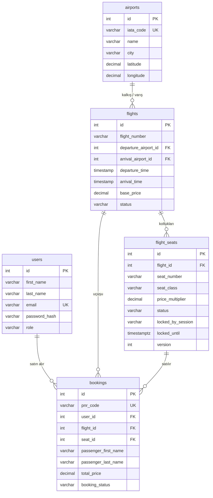

# 💾 Veritabanı Dokümanı

> PostgreSQL 17 · Veritabanı adı: `flight_booking` · Sorumlu: **1. Üye (Backend & Veritabanı)**

[← Ana README](../README.md)

---

## 📑 İçindekiler

- [Dosyalar](#-dosyalar)
- [Kurulum ve Güncelleme](#-kurulum-ve-güncelleme)
- [Bağlantı Bilgisi](#-bağlantı-bilgisi)
- [Tablo İlişkileri](#-tablo-i̇lişkileri)
- [Tablolar](#-tablolar)
- [Veritabanının Zorladığı Kurallar](#-veritabanının-zorladığı-kurallar)
- [Hazır Sorgular (Kim Ne Kullanacak)](#-hazır-sorgular)
- [Değişiklik Geçmişi](#-değişiklik-geçmişi)

---

## 📄 Dosyalar

| Dosya | Ne işe yarar |
| :--- | :--- |
| `schema.sql` | Tabloları, kuralları, view'ı ve trigger'ları oluşturur. **Önce bu çalışır.** Eski tabloları silip baştan kurar. |
| `seed.sql` | Örnek verileri ekler (havalimanları, uçuşlar, koltuklar, test kullanıcıları, test bileti). **Sonra bu çalışır.** |

## 🔧 Kurulum ve Güncelleme

pgAdmin'de `flight_booking` → **Tools → Query Tool** → klasör ikonu ile sırayla:

1. `schema.sql` aç → **F5**
2. `seed.sql` aç → **F5**

> 🔁 Bu klasörde bir değişiklik push'landığında `git pull` yapıp **iki adımı tekrar** çalıştırın. Kendi eklediğiniz test verileri silinir; bu normal.

## 🔗 Bağlantı Bilgisi

| Ayar | Değer |
| :--- | :--- |
| Host | `localhost` |
| Port | `5432` |
| Veritabanı | `flight_booking` |
| Kullanıcı | `postgres` |
| Şifre | *kurulumda kendi verdiğin şifre* |

Bağlantı adresi: `postgresql://postgres:<şifre>@localhost:5432/flight_booking`

> ⚠️ Herkesin veritabanı **kendi bilgisayarında**. Senin bilgisayarında alınan bilet, arkadaşının veritabanında görünmez. Herkes aynı `seed.sql` verisiyle başlar.

---

## 🧭 Tablo İlişkileri



---

## 📋 Tablolar

### `airports` · Havalimanları

| Kolon | Tip | Açıklama |
| :--- | :--- | :--- |
| `id` | SERIAL | Birincil anahtar |
| `iata_code` | VARCHAR(3) | `IST`, `ESB`… Benzersiz, 3 büyük harf |
| `name` | VARCHAR(150) | İstanbul Havalimanı |
| `city` | VARCHAR(100) | İstanbul |
| `country` | VARCHAR(100) | Varsayılan `Türkiye` |
| `latitude` / `longitude` | DECIMAL(9,6) | 🗺️ Harita için enlem / boylam |

### `flights` · Uçuşlar

| Kolon | Tip | Açıklama |
| :--- | :--- | :--- |
| `id` | SERIAL | Birincil anahtar |
| `flight_number` | VARCHAR(15) | `TK-2101` |
| `departure_airport_id` | INT → `airports` | Kalkış |
| `arrival_airport_id` | INT → `airports` | Varış |
| `departure_time` / `arrival_time` | TIMESTAMP | Kalkış / varış zamanı (havalimanı yerel saati) |
| `base_price` | DECIMAL(10,2) | Economy taban fiyat (TL) |
| `total_seats` | INT | Koltuk sayısı |
| `status` | VARCHAR(20) | `SCHEDULED` · `DELAYED` · `CANCELLED` · `COMPLETED` |

### `flight_seats` · Koltuklar

| Kolon | Tip | Açıklama |
| :--- | :--- | :--- |
| `id` | SERIAL | Birincil anahtar |
| `flight_id` | INT → `flights` | Hangi uçuşun koltuğu |
| `seat_number` | VARCHAR(5) | `1A` … `6F` |
| `seat_class` | VARCHAR(20) | `BUSINESS` · `ECONOMY` |
| `price_multiplier` | DECIMAL(4,2) | Business `1.50`, Economy `1.00` |
| `status` | VARCHAR(15) | `AVAILABLE` boş · `LOCKED` biri seçti, ödüyor · `BOOKED` satıldı |
| `locked_by_session` | VARCHAR(100) | Koltuğu tutan oturum / kullanıcı |
| `locked_until` | TIMESTAMPTZ | Kilidin biteceği zaman |
| `version` | INT | Optimistic locking sayacı |
| `updated_at` | TIMESTAMPTZ | Her güncellemede otomatik yenilenir |

### `users` · Kullanıcılar

| Kolon | Tip | Açıklama |
| :--- | :--- | :--- |
| `id` | SERIAL | Birincil anahtar |
| `first_name` / `last_name` | VARCHAR(100) | Ad / soyad |
| `email` | VARCHAR(150) | Giriş için kullanılır. Benzersiz, büyük/küçük harf duyarsız |
| `password_hash` | VARCHAR(255) | 🔐 **bcrypt** hash. Şifre asla düz metin saklanmaz |
| `phone` | VARCHAR(30) | İsteğe bağlı |
| `role` | VARCHAR(10) | `USER` · `ADMIN` |

### `bookings` · Biletler

| Kolon | Tip | Açıklama |
| :--- | :--- | :--- |
| `id` | SERIAL | Birincil anahtar |
| `pnr_code` | VARCHAR(6) | `TK19AB`. Benzersiz, 6 büyük harf / rakam |
| `user_id` | INT → `users` | Bileti **satın alan** hesap |
| `flight_id` | INT → `flights` | Uçuş |
| `seat_id` | INT → `flight_seats` | Koltuk |
| `passenger_*` | VARCHAR | **Uçacak** kişi: ad, soyad, TC/pasaport, e-posta, telefon |
| `total_price` | DECIMAL(10,2) | `base_price × price_multiplier` |
| `booking_status` | VARCHAR(20) | `CONFIRMED` · `CANCELLED` |

> Satın alan ile uçan kişi farklı olabilir: Ahmet giriş yapıp annesine bilet alabilir.

### `v_flight_search` · Arama view'ı

Uçuşu, iki havalimanının kod, şehir ve koordinatını ve **boş koltuk sayısını** tek satırda verir. Kolonlar: `flight_id`, `flight_number`, `departure_time`, `arrival_time`, `base_price`, `status`, `departure_code`, `departure_city`, `departure_airport`, `departure_lat`, `departure_lng`, `arrival_code`, `arrival_city`, `arrival_airport`, `arrival_lat`, `arrival_lng`, `available_seats`.

---

## 🚦 Veritabanının Zorladığı Kurallar

Bunlara uymayan bir `INSERT` / `UPDATE` hata verir. Backend'de bu hataları yakalayıp kullanıcıya anlamlı mesaj göstermek yeterli.

| Kural | Hata adı |
| :--- | :--- |
| Bir koltukta aynı anda yalnızca **1 aktif bilet** olabilir (iptal edilenin koltuğu tekrar satılabilir) | `uq_active_booking_per_seat` |
| Bilet, yalnızca **kendi uçuşuna ait** koltuğa kesilebilir | `fk_booking_seat_flight` |
| Aynı e-posta ile ikinci kez kayıt olunamaz | `uq_users_email` |
| `LOCKED` koltukta `locked_by_session` ve `locked_until` dolu, `AVAILABLE` / `BOOKED` koltukta boş olmalı | `chk_lock_fields` |
| PNR: 6 karakter, sadece `A-Z` ve `0-9` | `bookings_pnr_code_check` |
| Kalkış ve varış havalimanı aynı olamaz | `chk_different_airports` |
| Varış, kalkıştan sonra olmalı | `chk_valid_flight_times` |

---

## 🧩 Hazır Sorgular

### 🔐 Backend: kayıt ve giriş

```sql
-- Kayıt (password_hash backend'de bcrypt ile üretilir)
INSERT INTO users (first_name, last_name, email, password_hash, phone)
VALUES ($1, $2, $3, $4, $5)
RETURNING id, first_name, last_name, email, role;

-- Giriş: kullanıcıyı bul, sonra bcrypt.compare(girilenŞifre, password_hash)
SELECT id, first_name, last_name, email, password_hash, role
FROM users WHERE LOWER(email) = LOWER($1);
```

### 🔎 Backend / Frontend: uçuş arama

```sql
SELECT * FROM v_flight_search
WHERE departure_code = $1 AND arrival_code = $2
  AND departure_time::date = $3
  AND status <> 'CANCELLED'
ORDER BY departure_time;
```

### 📍 Frontend: harita

```sql
SELECT iata_code, city, latitude, longitude FROM airports;
```

Bir uçuşun güzergâhı için `v_flight_search` içindeki `departure_lat/lng` ve `arrival_lat/lng` yeterli.

### 💺 Koltuk haritası

```sql
-- Süresi dolmuş kilit boş gösterilir
SELECT id, seat_number, seat_class, price_multiplier,
       CASE WHEN status = 'LOCKED' AND locked_until < now()
            THEN 'AVAILABLE' ELSE status END AS status
FROM flight_seats
WHERE flight_id = $1
ORDER BY length(seat_number), seat_number;
```

### 🔒 Concurrency: koltuk kilitleme

**Optimistic (önerilen):** koltuğu `version` ile birlikte okuyup:

```sql
UPDATE flight_seats
SET status = 'LOCKED',
    locked_by_session = $2,
    locked_until = now() + INTERVAL '10 minutes',
    version = version + 1
WHERE id = $1
  AND version = $3
  AND (status = 'AVAILABLE' OR (status = 'LOCKED' AND locked_until < now()));
-- Etkilenen satır 0 → koltuğu başkası aldı
```

**Pessimistic:** transaction içinde satırı kilitleyip:

```sql
BEGIN;
SELECT * FROM flight_seats WHERE id = $1 FOR UPDATE;
-- durum uygunsa UPDATE ..., sonra
COMMIT;
```

> ⏱️ Kilit süresini her zaman SQL içinde `now() + INTERVAL '10 minutes'` ile hesaplatın. Backend'de (`new Date()` vb.) hesaplayıp parametre olarak göndermeyin; sunucu ile veritabanının saat dilimi farklıysa kilit hatalı süreli olur.

**Kilidi bırakma:**

```sql
UPDATE flight_seats
SET status = 'AVAILABLE', locked_by_session = NULL, locked_until = NULL, version = version + 1
WHERE id = $1 AND locked_by_session = $2;
```

### 🎫 Bilet satın alma (tek transaction)

```sql
BEGIN;
UPDATE flight_seats SET status = 'BOOKED', locked_by_session = NULL, locked_until = NULL,
       version = version + 1
WHERE id = $seat AND status = 'LOCKED' AND locked_by_session = $session
  AND locked_until > now();
-- etkilenen satır 0 ise ROLLBACK (kilit başkasında ya da süresi dolmuş)
INSERT INTO bookings (pnr_code, user_id, flight_id, seat_id,
                      passenger_first_name, passenger_last_name, passenger_identity_number,
                      passenger_email, passenger_phone, total_price)
VALUES (...);
COMMIT;
```

### ↩️ Bilet iptali (tek transaction)

```sql
BEGIN;
UPDATE bookings SET booking_status = 'CANCELLED'
WHERE pnr_code = $1 AND user_id = $2 AND booking_status = 'CONFIRMED'
RETURNING seat_id;
UPDATE flight_seats SET status = 'AVAILABLE', version = version + 1
WHERE id = $seat_id;
COMMIT;
```

### 📄 PDF: PNR ile bilet

```sql
SELECT b.pnr_code, b.booking_status, b.total_price, b.created_at,
       b.passenger_first_name, b.passenger_last_name, b.passenger_identity_number,
       s.seat_number, s.seat_class,
       v.flight_number, v.departure_time, v.arrival_time,
       v.departure_code, v.departure_city, v.departure_airport,
       v.arrival_code, v.arrival_city, v.arrival_airport
FROM bookings b
JOIN flight_seats s     ON s.id = b.seat_id
JOIN v_flight_search v  ON v.flight_id = b.flight_id
WHERE b.pnr_code = $1;
```

### 🧾 Biletlerim

```sql
SELECT b.pnr_code, b.booking_status, b.total_price,
       v.flight_number, v.departure_code, v.arrival_code, v.departure_time, s.seat_number
FROM bookings b
JOIN flight_seats s    ON s.id = b.seat_id
JOIN v_flight_search v ON v.flight_id = b.flight_id
WHERE b.user_id = $1
ORDER BY v.departure_time;
```

---

## 🕓 Değişiklik Geçmişi

| Tarih | Değişiklik |
| :--- | :--- |
| 22.10.2026 | İlk sürüm: `airports`, `flights`, `flight_seats`, `users`, `bookings`, `v_flight_search` |
